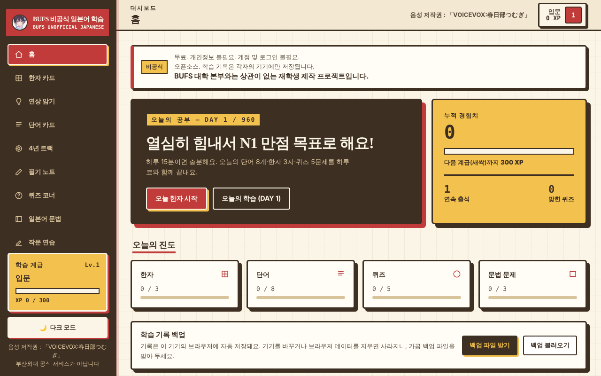
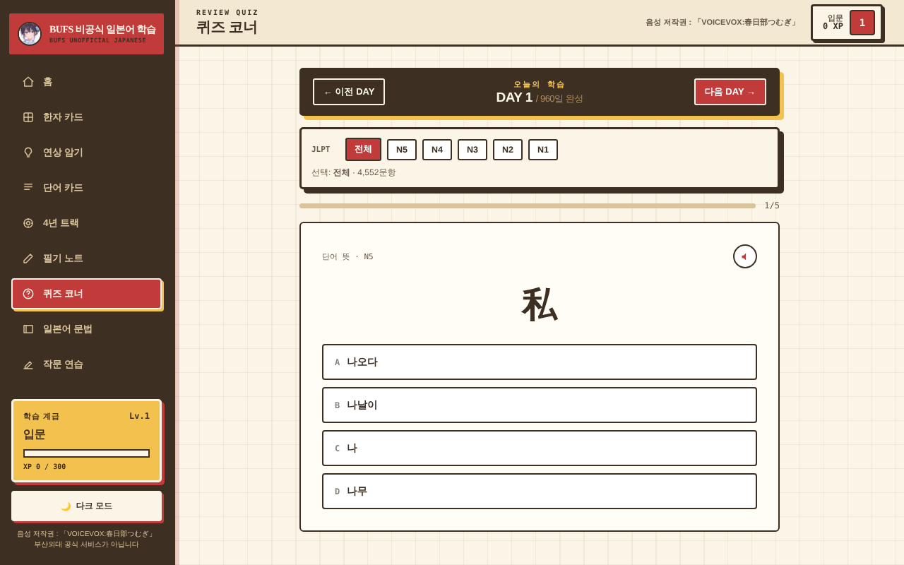
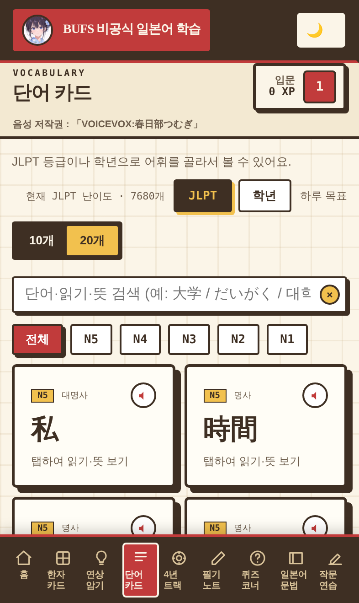

# BUFS 비공식 일본어 학습

부산외국어대학교 일본어융합학부 학생이 **4년 동안 하루 15분씩** 공부해 **JLPT N1 만점**을 노리도록 만든 무료 일본어 학습 웹앱입니다.
마스코트는 오리지널 캐릭터 **하루코(春子)**, 발음은 **VOICEVOX:春日部つむぎ** 목소리입니다.

> 부산외국어대학교의 공식 서비스가 아닙니다. 재학생이 후배들을 위해 만든 비공식 앱입니다.



## 한눈에 보기

- **하루 분량**: 단어 8개 · 한자 3자 · 퀴즈 5문제 · 문법 확인 문제 3개 (약 15분)
- **4년 = DAY 1~960**: 1년을 240학습일(주 5일 × 48주)로 계산
- **브라우저에서 바로, 앱처럼 설치도**: PC · 아이패드 · 아이폰 · 안드로이드 ([설치 방법](#앱으로-설치하기))
- **오프라인 사용**: 처음 한 번 접속하면 화면과 학습 데이터가 기기에 저장되어 인터넷이 없어도 열립니다.
- **서버·AI 없음**: 정적 파일만으로 동작하고, 운영 비용은 무료 호스팅 안에서 0원입니다. 외부 CDN도 쓰지 않습니다.

## 4년 커리큘럼

| 학년 | 목표 | 어휘 | 한자(상용한자) |
|---|---|---|---|
| 1학년 | N4 합격 | 1,920 (N5 900 + N4 1,020) | 720 |
| 2학년 | N3 합격 | 1,920 (N3) | 720 |
| 3학년 | N2 합격 | 1,920 (N2) | 696 (2,136자 완료) |
| 4학년 | N1 만점 | 1,920 (N1 약 1,620 + N2 심화 약 300) | 복습 |

## 기능

| 메뉴 | 내용 |
|---|---|
| 홈 | 오늘의 DAY와 학년·학기, 오늘의 진도, 경험치·계급, 학습 기록 백업 |
| 한자 카드 | 상용한자 2,136자(N5~N1), 음·훈·뜻·예시 |
| 연상 암기 | 한자마다 한국어 연상법(부품 → 이야기 → 뜻·음), 셀프 채점 복습 |
| 단어 카드 | 어휘 7,680개, JLPT 등급·학년으로 보기, 검색 |
| 4년 트랙 | 학년별 어휘 진도, 「인지 가능」(経済→경제처럼 한국 한자음과 같은 말) / 「암기 필요」 구분 |
| 필기 노트 | 한자·어휘 따라쓰기. 애플펜슬 필압 지원, 펜을 쓰면 손바닥 입력 무시, 펜이 없으면 손가락 필기 |
| 퀴즈 코너 | 하루 5문제(그날 단어 중 외워야 하는 4개 + 한자 1자), 4년 4,552문항. N5~N1 등급별 퀴즈 |
| 일본어 문법 | N5~N1 227단원, 단원마다 설명·규칙·예문 2개 이상·확인 문제 3개 |
| 작문 연습 | 1,230문항: 문장 일작 450 · 경어 120 · 비즈니스 80 · 주제 작문 80(일상·의견문·취업 ES) · 단어 조합 500. 모범 답안 비교와 규칙 점검으로 채점 |





## 학습 기록

- 경험치 · 연속 출석 · 맞힌 퀴즈 · 카드 확인 목록 · 오늘의 진도 · 퀴즈 DAY · 연상 암기 기록이 **각 기기의 브라우저**에 자동 저장됩니다(계정 없음).
- 기기를 바꾸거나 브라우저 데이터를 지우면 사라집니다. 홈의 **「백업 파일 받기 / 백업 불러오기」**로 옮기거나 보관하세요.
- 경험치는 같은 카드·문제에서 **처음 한 번만** 받습니다.

**계급** (하루 분량을 다 하면 약 45 XP)

| 계급 | 필요 XP | 대략 시점 |
|---|---|---|
| 입문 · 새싹 · 초급 · 초급 숙련 | 0 · 300 · 1,200 · 3,000 | 시작 · 1주 · 4주 · 2달 |
| 중급 입문 · 중급 · 중급 숙련 | 6,000 · 10,000 · 15,000 | 4.5달 · 1학년 말 · 1.4년 |
| 상급 입문 · 상급 · 고급 · N1 도전 | 21,000 · 28,000 · 35,000 · 42,000 | 2학년 말 · 2.6년 · 3.2년 · 4학년 말 |

**경험치**: 퀴즈 정답 +5 · 단어 조합 첫 채점 +8/+4/+2 · 일반 작문 첫 채점 +5/+2 · 연상 암기 「외웠어요」 +3 · 모범 답안 첫 보기 +3 · 한자 카드 +2 · 문법 확인 문제 +2 · 단어 카드 +1

## 발음

1. **미리 만든 음성 파일**(`audio/`, 10,136개): 단어 읽기 · 한자 음/훈 · 문법 예문 · 작문 모범 답안. 무료·무제한이고 모든 기기에서 같은 목소리로 나옵니다.
2. **브라우저 일본어 음성**: 파일이 없는 문장에만 사용합니다(작문 연습의 직접 입력 문장 등).

크레디트: **VOICEVOX:春日部つむぎ** — 앱의 모든 화면에 표시합니다.

## 앱으로 설치하기

| 기기 | 방법 |
|---|---|
| 아이폰 · 아이패드 | Safari에서 열기 → 공유 버튼 → **홈 화면에 추가** |
| 안드로이드 | Chrome에서 열기 → 홈 화면의 **「설치하기」** 카드(또는 메뉴 → 앱 설치) |
| PC (Chrome · Edge) | 열기 → 주소창 오른쪽 설치 아이콘(또는 홈 화면의 **「설치하기」** 카드) |

- 처음 한 번은 인터넷이 필요합니다. 이후 화면·학습 데이터는 오프라인에서도 열리고, **들어 본 음성**도 오프라인에서 재생됩니다(안 들어 본 문장은 기기의 일본어 음성으로 대신 읽습니다).
- 아이폰의 홈 화면 앱은 Safari와 기록 저장 공간이 따로입니다. 기존 기록이 있으면 먼저 홈의 「백업 파일 받기」로 저장하고, 홈 화면 앱에서 「백업 불러오기」를 하세요.
- 서비스 워커(`sw.js`)에 문제가 생기면 파일 머리말 주석의 방법(해제용 두 줄로 교체해 배포)으로 모든 기기에서 끌 수 있습니다.

## 실행

```bash
python3 -m http.server 8000
```

브라우저에서 `http://localhost:8000`을 엽니다. 빌드 단계는 없습니다.

## 배포

정적 사이트라서 저장소 루트를 그대로 올리면 됩니다. 환경변수·서버 설정이 필요 없고 빌드 단계도 없습니다.

| 호스팅 | 설정 | 헤더(캐시·보안) |
|---|---|---|
| Cloudflare (Workers 정적 배포 / Pages) | Workers & Pages → Create → Git 연결 → 저장소 선택 → **Build command 비움 · 루트 디렉터리 `/`** → Deploy. Worker 이름은 `wrangler.jsonc`의 `name`과 같게 | `_headers` · `wrangler.jsonc` · `.assetsignore`(개발·문서 파일은 올리지 않음) |
| Vercel | 저장소를 Import(Framework: Other, 환경변수 없음). `.vercelignore`가 `tests/`를 제외 | `vercel.json` |
| GitHub Pages · Netlify | 저장소 루트를 그대로 게시 | 두 파일을 읽지 않음 — 캐시·보안 헤더는 직접 설정 |

- `_headers`와 `vercel.json`은 같은 내용을 유지합니다(`node tests/run.cjs security`가 일치 여부를, `node tests/run.cjs assets`가 업로드 목록에 필수 파일이 있는지를 검사).
- 저장소 공개 파일에는 개인 계정 이름이 들어간 배포 주소(호스팅 업체가 주는 기본 주소 등)를 적지 않습니다(`assets` 검사가 막음).
- **주소(도메인)가 바뀌면 브라우저 저장 공간도 달라져서 기존 학습 기록이 새 주소에 보이지 않습니다.** 옛 주소에서 홈의 「백업 파일 받기」로 저장한 뒤, 새 주소에서 「백업 불러오기」를 하세요.

## 데이터 다시 만들기

앱이 읽는 데이터는 `data/*.json`입니다. 원본부터 다시 만들 때는 아래 순서로 실행합니다(저장소 루트에서).

```bash
cd data && node lib/build.mjs && cd ..
```

```bash
node scripts/build_curriculum.mjs
```

```bash
node scripts/build_quiz_pool.mjs
```

```bash
node scripts/build_writing.mjs
```

```bash
node scripts/augment_grammar.mjs
```

```bash
node scripts/check-writing-combo.mjs
```

| 스크립트 | 하는 일 |
|---|---|
| `data/lib/build.mjs` | 공개 사전(KANJIDIC2·JMdict)과 직접 쓴 한국어 데이터를 합쳐 전체 어휘·한자·문법·작문 생성 |
| `scripts/build_curriculum.mjs` | 전체에서 4년 커리큘럼 어휘 7,680개·상용한자 2,136자를 골라 학년·DAY 부여 |
| `scripts/build_quiz_pool.mjs` | 퀴즈 범위(하루 단어 4 + 한자 1) |
| `scripts/build_writing.mjs` | 작문 1,230문항 선별 |
| `scripts/augment_grammar.mjs` | 문법 보강(`data/lib/grammar_supplement.mjs`) 합치기 |
| `scripts/check-writing-combo.mjs` | 단어 조합 문제 검사 |
| `scripts/build_voice.mjs` | VOICEVOX 엔진으로 음성 파일 생성(이미 있는 파일은 건너뜀) |

음성 파일 생성은 VOICEVOX 엔진이 필요합니다.

```bash
docker run -d -p 50021:50021 voicevox/voicevox_engine:cpu-0.26.1
```

```bash
node scripts/build_voice.mjs
```

데이터 생성 기준과 스키마는 [`data/README.md`](data/README.md), 출처는 [`docs/data-sources.md`](docs/data-sources.md)에 있습니다.

## 개발

- 코드 구조(실행 흐름 · 화면별 코드 위치 · 저장 키 · 함정): [`docs/ARCHITECTURE.md`](docs/ARCHITECTURE.md)
- 회귀 테스트(화면·오프라인·보안): `node tests/run.cjs` — 준비와 사용법은 [`tests/README.md`](tests/README.md)

## 폴더 구성

| 경로 | 내용 |
|---|---|
| `index.html` | 앱 본체(화면 템플릿 + 로직) |
| `support.js` | 화면 렌더링 런타임 |
| `vendor/` | React 18.3.1(외부 CDN 없이 자체 포함, MIT) |
| `sw.js` · `pwa.js` · `manifest.webmanifest` · `icons/` | 앱 설치 · 오프라인 |
| `tts.js` | 발음 재생(음성 파일 → 브라우저 음성) |
| `combo_check.js` | 단어 조합 작문 규칙 점검 |
| `audio/` | VOICEVOX:春日部つむぎ 음성 파일 |
| `data/` | 학습 데이터(JSON)와 생성 코드 |
| `scripts/` | 커리큘럼·퀴즈·작문·문법·음성 생성 스크립트 |
| `tests/` | 회귀 테스트(배포에서 제외) |
| `docs/` | 구조 안내 · 데이터 출처 |
| `haruko.jpg` | 마스코트 하루코 |

## 라이선스

| 부분 | 라이선스 |
|---|---|
| 코드 | MIT ([`LICENSE`](LICENSE)) |
| 한자·어휘·문법·작문 데이터 | CC BY-SA 4.0 (KANJIDIC2·JMdict © EDRDG 포함) |
| 음성 파일 | VOICEVOX:春日部つむぎ — 크레디트 표시 필수, VOICEVOX·캐릭터 이용규약 준수 |
| 하루코 이미지 | CC BY 4.0 |

자세한 조건은 [`NOTICE.md`](NOTICE.md)를 보세요. JLPT는 공식 출제 목록을 공개하지 않으므로, 이 앱의 등급 분류는 공개 데이터를 바탕으로 한 학습용 분류입니다.
